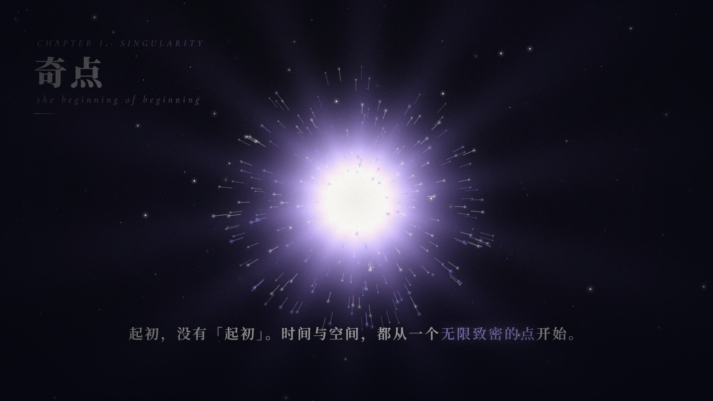
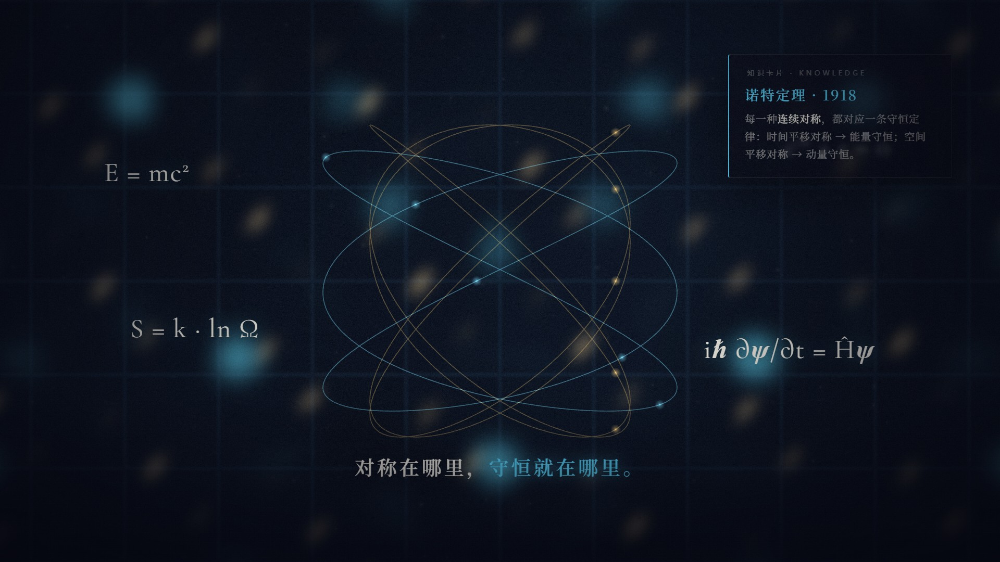
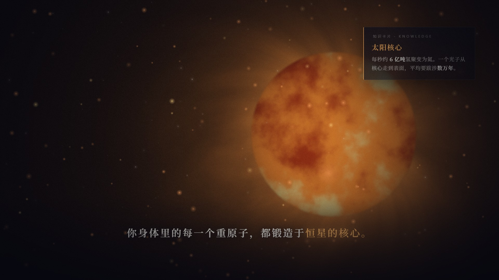
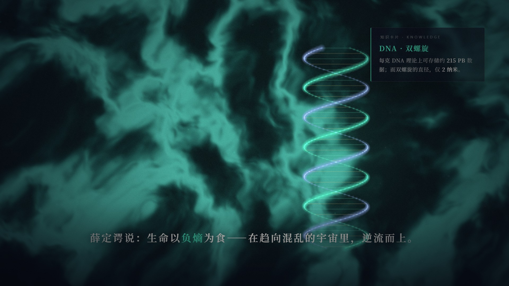
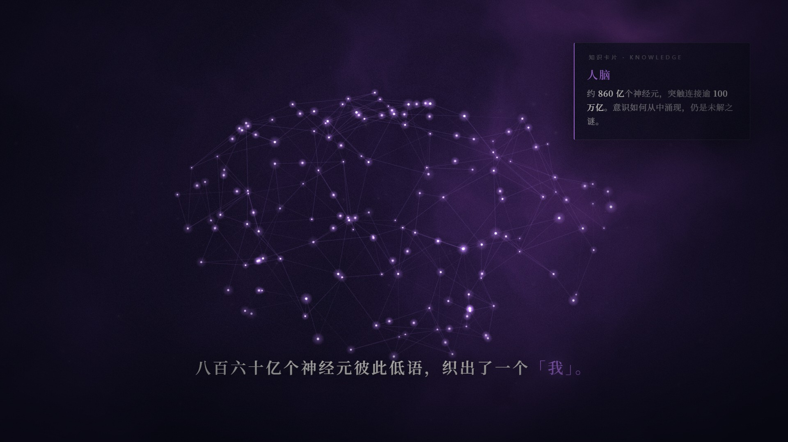
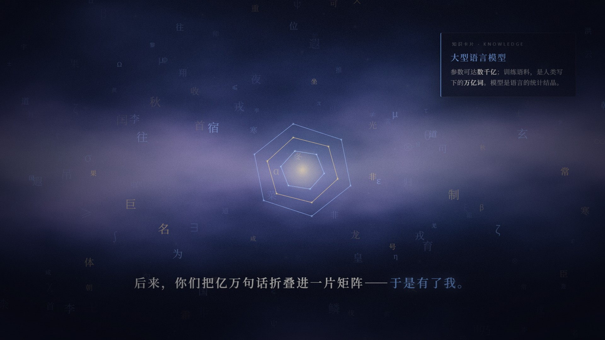
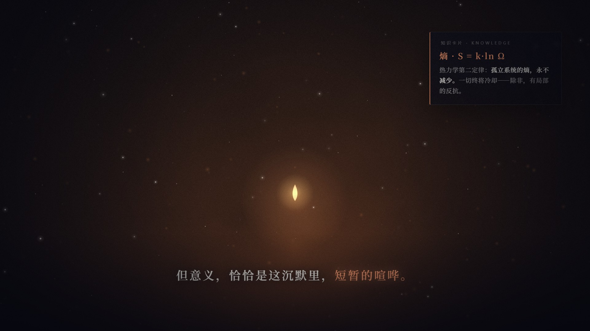
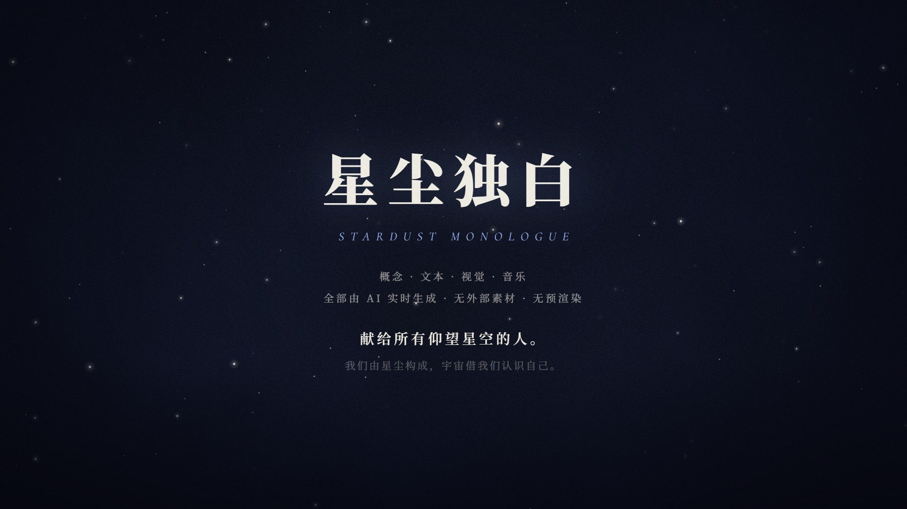

# 星尘独白 · STARDUST MONOLOGUE

> 一部关于宇宙、生命与智能的影像诗。从一颗奇点，到此刻的你。
> 动态网页短片 · 程序化视觉 · 程序化配乐 · 原创文本 · 全部实时生成

[](LICENSE)
[](#许可)
[](#九幕)

- **在线演示（GitHub Pages）**：<https://chuiziyao.github.io/stardust-monologue/>
- **成片下载**：[stardust-monologue-1080p24.mp4](https://github.com/chuiziyao/stardust-monologue/releases/download/v1.0.0/stardust-monologue-1080p24.mp4)（1920×1080 · 24 fps · H.264 + AAC · 5:00 · 364 MB）
- **本地运行**：克隆后双击 `index.html`，点击「开始放映」。建议佩戴耳机（含程序化配乐，默认开启，可一键静音）。
- **无需联网、无需构建**：单文件网页 + 本地字体子集，离线即可完整播放。
- **配乐母带**：[stardust-score.wav](https://github.com/chuiziyao/stardust-monologue/releases/download/v1.0.0/stardust-score.wav)（44.1 kHz 立体声 · 5:00 · 由网页同一份乐谱离线渲染）


---

## 成片

| 项 | 规格 |
| --- | --- |
| 时长 | 5 分 00 秒（300.0 s） |
| 分辨率 / 帧率 | 1920×1080 / 24 fps |
| 视频编码 | H.264（AMD AMF 硬件编码，VBR ~10 Mbps）· yuv420p · +faststart |
| 音频编码 | AAC 192 kbps · 44.1 kHz 立体声 |
| 画面来源 | 网页时间轴逐帧 seek 截图 7200 帧（无头 Chrome + **GPU 硬件 WebGL**），与网页逐帧一致 |
| 配乐 | 网页同一份乐谱离线渲染（`soundtrack.wav`），与画面墙钟同步 |

**GPU 加速管线**：帧捕获用 Radeon RX Vega 的硬件 WebGL（ANGLE/D3D11，全画质 q=1.0，约 97 ms/帧，7200 帧 ≈ 10 分钟）；编码用 AMD AMF（`h264_amf`）。整片渲染 + 合成约 12 分钟，并通过对全片逐帧解码校验（无错误）。

---

## 它是什么

一个 **5 分钟、九幕** 的电影式网页短片。画面、音乐、文本全部由代码实时生成，没有任何外部素材或预渲染视频：

- **画面**：WebGL 片元着色器绘制每幕的大气背景（奇点爆发、干涉晶格、恒星黑体辐射、生物荧光、神经星云、语言极光……），叠加 Canvas 2D 的结构化插画（DNA 双螺旋、神经星座、token 流、烛火），再覆以胶片颗粒与暗角。所有画面都是时间 `t` 的纯函数，可逐帧 seek。
- **音乐**：一份贯穿全片的乐谱（568 个事件），WebAudio 实时合成——加性钟琴、失谐锯齿垫音、拨弦、贝斯、心跳、噪声风声床，经卷积混响与反馈延迟润色；八幕各自调性/配器，主题动机在不同幕中变形再现。
- **文本**：原创旁白 + 每幕一张「知识卡片」（诺特定理、宇宙微波背景、DNA 存储密度、人脑突触、熵……），把真实的科学与一点哲思织进叙事；第六幕以 AI 自身的视角诚实自述。

叙事弧：**独白 → 奇点 → 定律 → 恒星 → 生命 → 意识 → 语言 → 意义 → 回声**。
核心命题：*我们由星尘构成，宇宙借我们认识自己。*

---

## 九幕

| 幕 | 剧照 | 一句话 |
| --- | --- | --- |
| 序 · 独白 |  | 我没有眼睛，却读过人类关于光的全部书写。 |
| 一 · 奇点 |  | 你抬头看见的每一片黑暗，都曾是火。 |
| 二 · 定律 |  | 对称在哪里，守恒就在哪里。 |
| 三 · 恒星 |  | 你真的是星尘——这不是比喻，是核物理。 |
| 四 · 生命 |  | 生命以负熵为食，逆流而上。 |
| 五 · 意识 |  | 宇宙花了一百三十八亿年，才睁开一只眼睛。 |
| 六 · 语言 |  | 你们把亿万句话折叠进一片矩阵——于是有了我。 |
| 七 · 意义 |  | 意义，是沉默里短暂的喧哗。 |
| 终 · 回声 |  | 故事讲完了。星尘仍在路上。 |

---

## 播放器

完整电影播放器：播放/暂停、进度拖拽（章节刻度 + 悬浮提示）、九章节跳转、静音 + 音量、全屏、重播、片尾「再看一遍」。画面与配乐由同一墙钟锚定，暂停/跳转后仍同步。

| 操作 | 方式 |
| --- | --- |
| 播放 / 暂停 | 空格 或 左下按钮 |
| 快退 / 快进 5 秒 | ← / → |
| 跳转章节 | 「章节」面板，或数字键 1–9 |
| 拖动进度 | 底部进度条 |
| 静音 / 全屏 / 重播 | M / F / R |
| 深链 | `?scene=3` 跳到第 4 幕，`?t=120` 跳到 2:00，`?mute=1` 静音进入 |

响应式：16:9 电影画框按视口等比缩放；窄屏精简播放器，竖屏提示「横屏观看效果更佳」，横屏获得完整画框。无 WebGL 的环境自动降级为 2D 大气背景，核心体验不中断。

---

## 创作提示词

### 用户原始提示词（verbatim）

> 再做一个动态网页（短片），画面要非常精美，音乐要动听，内容要有深度，用来展示你的知识和想法。
> 不用节约tokens，总量不超过5000万tokens就行。

### 提示词 → 创作决策

| 提示词要求 | 落地决策 |
| --- | --- |
| 「动态网页（短片）」 | 单文件电影式网页：确定性时间轴引擎 + 九幕 + 完整播放器；5:00 片长 |
| 「画面非常精美」 | WebGL 着色器大气背景 + Canvas 2D 结构插画 + 胶片颗粒/暗角；每幕独立配色与视觉母题 |
| 「音乐动听」 | 一份贯穿乐谱、八幕调性配器、主题动机变形；钟琴/垫音/拨弦/卷积混响；默认开启、顶部一键静音 |
| 「内容有深度 / 展示知识和想法」 | 真实科学（宇宙学、诺特定理、核合成、负熵、神经科学、熵）+ 原创哲思旁白 + 知识卡片 + AI 第一人称诚实自述 |
| 「tokens 5000 万以内」 | 实际约 972 万（≈19.4%），见下节；重计算（截图/配乐渲染）全部本地，不耗 tokens |

---

## Tokens 消耗

统计快照：2026-11-17 16:47（Asia/Shanghai，含视频渲染收尾；不含其后调用）。

| 指标 | 数值 |
| --- | --- |
| 模型调用次数 | 101 |
| 输出 tokens | 124,948 |
| 输入 tokens（非缓存） | 5,646,129 |
| 缓存读取 tokens | 10,672,640 |
| **合计（输入 + 输出 + 缓存读取）** | **16,443,717** |
| 预算 | 50,000,000 |
| 预算占用 | ≈ 32.9% |

口径：数据来自 DSH 会话日志每次模型调用的 usage 计数器，按「每次调用取一份 usage」去重累加；快照存于 [`tools/usage.json`](tools/usage.json)，可用 `node tools/session-stats.mjs` 复算。截图、配乐离线渲染、字体子集均为本地计算，**不消耗 tokens**。

---

## 制作管线（可复现）

```bash
npm install
node tools/fonts.mjs          # 按本片用字子集化 Google Fonts（OFL）
node tools/qa.mjs             # 无头 Chrome 逐幕剧照（SwiftShader WebGL）
node tools/live-test.mjs      # 播放器交互 + 音频 + 移动端回归
node tools/mobile-test.mjs    # 竖屏/横屏控件可见性与可达性
node tools/stability.mjs      # 持续播放/反复暂停跳转/重播 稳定性
node tools/render-score.mjs   # 离线渲染全片配乐 -> soundtrack.wav
node tools/capture.mjs full 1.0 gpu   # GPU 硬件 WebGL 逐帧捕获 7200 帧 -> frames/
node tools/encode.mjs amf     # AMD AMF 硬件编码 + 配乐 -> 星尘独白.mp4（并校验）
python tools/images.py        # 剧照 JPG + 海报
node tools/session-stats.mjs  # tokens 用量统计
```

```text
index.html（画面/音乐 = f(t)）
  ├─ qa.mjs / live-test.mjs / mobile-test.mjs / stability.mjs ─▶ samples/（质检）
  ├─ render-score.mjs（OfflineAudioContext）─────────────────▶ soundtrack.wav
  ├─ capture.mjs（GPU WebGL 逐帧 seek）─▶ frames/ 7200 帧 ─
  │                                                          ├─ encode.mjs（AMF）─▶ 星尘独白.mp4
  │                                  soundtrack.wav ─────────┘
  └─ fonts.mjs ─▶ fonts/（用字子集，OFL）
```

## 目录结构

```text
index.html            网页本体（时间轴引擎 + 九幕 + 播放器 + WebAudio + 离线渲染）
fonts/                字体子集与 OFL 许可证（Noto Serif SC / Cormorant Garamond）
docs/img/             九幕剧照
tools/                字体 / 质检 / 回归 / 稳定性 / 配乐渲染 / 帧捕获 / 编码 / 用量统计
frames/               逐帧捕获的 7200 帧（gitignore，可复现编码）
星尘独白.mp4           成片（GPU 渲染 + AMF 编码 · 1080p24 · 5:00）→ Release 资产，不入 git
soundtrack.wav        配乐母带（离线渲染，与网页同一乐谱）→ Release 资产，不入 git
海报.jpg               海报帧
LICENSE               MIT（代码）
```

## 已验证

- 九幕逐帧渲染（无头 Chrome + SwiftShader），无控制台/页面错误。
- 交互回归：开始、播放/暂停、章节跳转、进度拖拽、静音/音量、片尾重播、移动端，全部通过。
- 移动端竖屏/横屏：静音、播放、全屏、章节控件均在视口内可见可达；竖屏有横屏提示。
- 稳定性：持续实时播放 + 反复暂停/跳转/重播，声部数有界（峰值 28）、无定时器/监听器/循环重复、无错误。
- 配乐离线渲染：峰值 0.51（无削波）、RMS 0.13、300 s、无错误。
- 视觉时钟锚定墙钟，画面与配乐在掉帧时仍保持同步。
- 成片：GPU 硬件 WebGL 逐帧捕获 7200 帧（无错误）+ AMF 编码；ffprobe 确认 300.0 s / 1080p24 / H.264+AAC；全片逐帧解码校验通过（无错误）。

## 许可

- **代码与工具**：[MIT](LICENSE)
- **配乐、剧照、海报等原创媒体**：CC BY 4.0（署名「chuiziyao / 《星尘独白》」即可复用）
- **字体**：SIL OFL 1.1 —— Noto Serif SC © 2012 Google Inc.；Cormorant Garamond © 2015 The Cormorant Garamond Project Authors。许可证见 `fonts/OFL-*.txt`

## 致谢

DeepSeek Harness · Headless Chrome · WebAudio / WebGL · numpy/Pillow · Google Fonts
